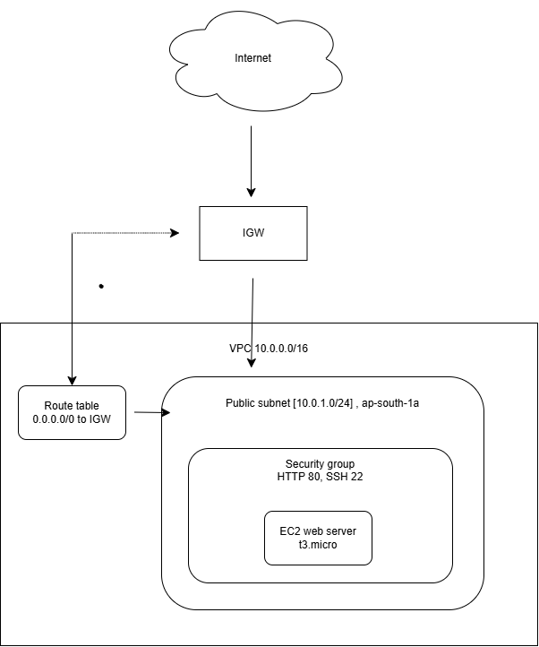
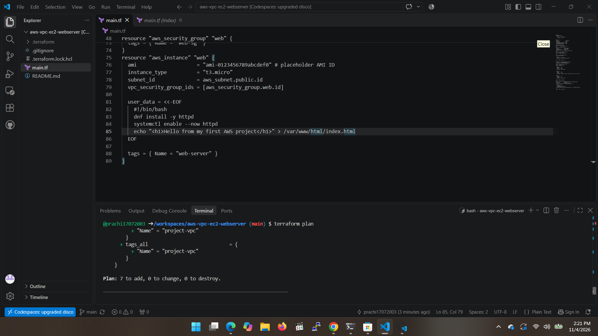
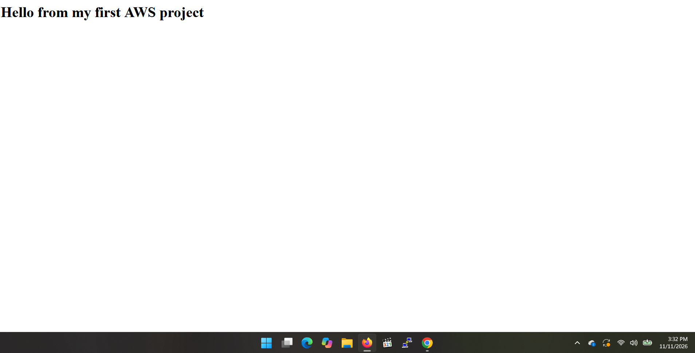
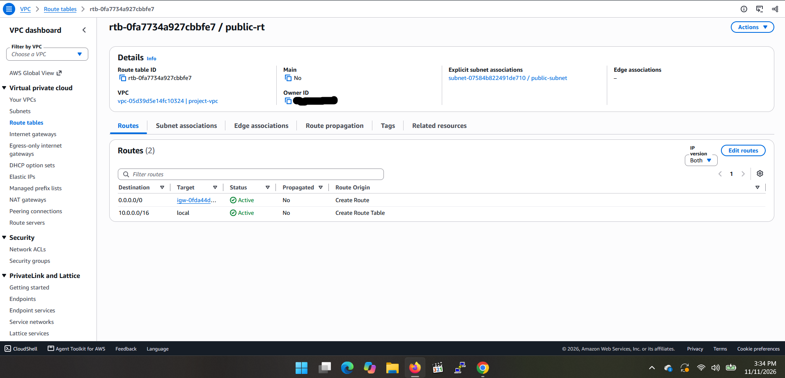
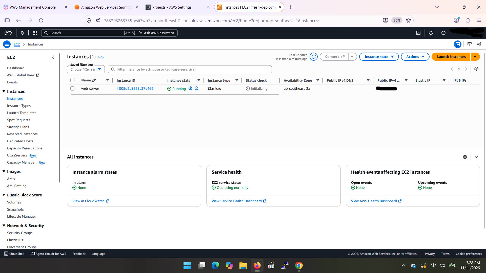

# AWS VPC + EC2 Web Server (Terraform)

Designed a web server inside a custom AWS VPC using Terraform.
**Status:** Terraform version validated with `terraform plan` (not deployed).
Console version built and tested live in AWS, then deleted.

## Architecture

## What it builds
| Resource | Purpose |
|---|---|
| VPC (10.0.0.0/16) | Private network |
| Public subnet (10.0.1.0/24, ap-south-1a) | Holds the web server |
| Internet gateway | Gives the VPC internet access |
| Route table (0.0.0.0/0 -> IGW) | Sends outside traffic to the gateway |
| Route table association | Makes the subnet public |
| Security group | Allows HTTP (80) from anywhere, SSH (22) from one IP |
| EC2 (t3.micro) | Web server installed through user data |

## How I validated it
`terraform init`, `terraform validate` and `terraform plan` run in GitHub
Codespaces. Plan result: 7 to add, 0 to change, 0 to destroy.

## Key concepts
## Key concepts
- **Why the subnet is public:** its route table sends `0.0.0.0/0` traffic to the
  internet gateway, and the route table is associated with the subnet. Without
  that association the subnet would use the default route table and have no
  path to the internet.
- **Why SSH is limited to one IP:** port 22 gives remote control of the server,
  so I allow it from a single address (`/32`) instead of `0.0.0.0/0`. Opening
  SSH to the whole internet invites constant brute-force attempts. HTTP on
  port 80 is open to all because it is a public website.
- **What stateful means for the security group:** if a request is allowed in,
  the reply is allowed out automatically, so I don't write separate return
  rules. A NACL is stateless and would need rules in both directions.

## Challenges
- Windows Application Control blocked the Terraform plugin on my laptop,
  so I ran Terraform in GitHub Codespaces instead.

## What I would do next
- Add a private subnet and NAT gateway
- Add an IAM role and S3 bucket
- Deploy it with `terraform apply` and destroy afterwards

## Tools
Terraform, AWS (VPC, EC2), GitHub Codespaces

## Console version (built and tested live)

I also built the same architecture by hand in the AWS Management Console
(Sydney region) to understand each piece before automating it.

| Step | What I did |
|---|---|
| 1 | Created the VPC (10.0.0.0/16) |
| 2 | Created a public subnet (10.0.1.0/24) with auto-assign public IP |
| 3 | Created an internet gateway and attached it to the VPC |
| 4 | Created a route table with 0.0.0.0/0 to the IGW and linked it to the subnet |
| 5 | Created a security group: HTTP 80 from anywhere, SSH 22 from my IP only |
| 6 | Launched a t3.micro EC2 instance with a user data script that installs Apache |
| 7 | Opened the public IP in a browser and confirmed the page loaded |
| 8 | Terminated the instance and deleted the VPC to avoid charges |

### What I learned
- A subnet is public because of its route table (0.0.0.0/0 to the IGW), not its name.
- A new subnet uses the VPC's main route table until you associate your own.
- The Terraform blocks map one-to-one to these console steps.
- 251, not 256: the subnet showed 251 available addresses. AWS reserves 5 in every subnet, so /24 doesn’t give you all 256.
- Not public until the association: the gateway and the route both existed, but the subnet kept using the main route table until you linked public-rt.
- Terraform vs the console: Terraform created the attachments for you through references like vpc_id, but in the console you had to remember to attach the gateway and associate the route table yourself.

